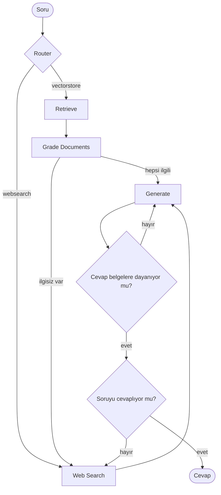

# Corrective / Self-RAG with LangGraph

Cevabını kendi kendine kontrol eden bir RAG (Retrieval-Augmented Generation) sistemi.
Soruyu doğru kaynağa yönlendirir, bulduğu belgelerin işe yarayıp yaramadığını denetler,
gerekirse internette arar ve üretilen cevabın uydurma (halüsinasyon) olup olmadığını kontrol eder.

> Corrective/Self-RAG built with LangGraph: query routing, document grading, web search fallback and hallucination checks.

## Nasıl çalışır?



| Adım | Görev |
|---|---|
| **Router** | Soruyu vektör veritabanına mı, web aramasına mı yönlendireceğine karar verir |
| **Retrieve** | Chroma veritabanından soruya en yakın parçaları getirir |
| **Grade Documents** | Her belgeyi "soruyla ilgili mi?" diye puanlar, ilgisizse web aramasına geçer |
| **Web Search** | Tavily ile internette arama yapar |
| **Generate** | Belgelere dayanarak kısa cevap üretir |
| **Hallucination Grader** | Cevabın belgelerle desteklenip desteklenmediğini kontrol eder |
| **Answer Grader** | Cevabın soruyu gerçekten çözüp çözmediğini kontrol eder |

## Kullanılan teknolojiler

- [LangGraph](https://github.com/langchain-ai/langgraph) ile akış yönetimi
- [LangChain](https://www.langchain.com/) ve Claude (`langchain-anthropic`) ile LLM zincirleri
- [Chroma](https://www.trychroma.com/) vektör veritabanı
- `sentence-transformers/all-MiniLM-L6-v2` ile yerel embedding
- [Tavily](https://tavily.com/) ile web araması

## Proje yapısı

```
CorrectiveRAG/
├── VectorDB.py          # Belgeleri indirir, parçalar, Chroma'ya kaydeder
├── main.py              # Çalıştırma noktası
├── graph/
│   ├── graph.py         # LangGraph akışı ve karar fonksiyonları
│   ├── state.py         # Grafın ortak durumu (GraphState)
│   ├── node_constants.py
│   ├── chains/          # Router, grader'lar ve cevap üreten zincirler
│   └── nodes/           # retrieve, grade_documents, web_search, generate
└── requirements.txt
```

## Kurulum

```bash
git clone https://github.com/hanifeecobann/corrective-rag.git
cd corrective-rag

python -m venv .venv
.venv\Scripts\activate        # Windows
# source .venv/bin/activate   # macOS / Linux

pip install -r requirements.txt
```

`.env.example` dosyasını `.env` olarak kopyalayıp anahtarlarını yaz:

```
ANTHROPIC_API_KEY=...
TAVILY_API_KEY=...
```

## Çalıştırma

```bash
python main.py
```

İlk çalıştırmada üç blog yazısı indirilir ve `.chroma/` klasörüne indekslenir (birkaç dakika sürebilir). Sonraki çalıştırmalar hızlıdır.

Soruyu değiştirmek için `main.py` içindeki `question` değerini düzenle.

## Bilinen sınırlar ve geliştirme fikirleri

- Cevap üretimi belgelere dayanmıyorsa `generate` adımı tekrar denenir. Sonsuz döngüyü önlemek için deneme sınırı eklenebilir.
- Belgeler yetersizse soruyu yeniden yazıp tekrar aramak (query rewriting) kaliteyi artırır.
- Cevaplara kaynak (URL) göstermek ve sohbet hafızası eklemek.
- RAGAS gibi bir araçla doğruluk ölçümü yapmak.
